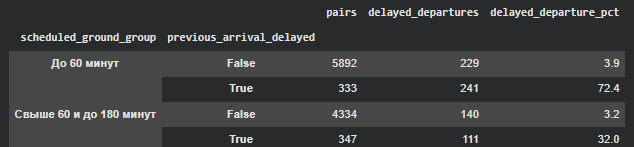
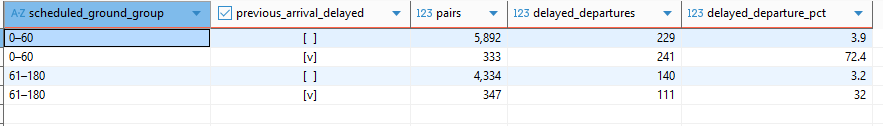

# Flight Delay Chains

Анализ задержек рейсов в pandas и PostgreSQL. Проверяю, как опоздание борта на предыдущем рейсе связано с задержкой следующего вылета и что меняется при разной стоянке по расписанию.

В исходных данных BTS **539 747 рейсов за январь 2025 года**. Соседние рейсы ищу по всему месяцу, а итоговое сравнение делаю для вылетов с плановой датой **15 января 2025 года**. В него вошли **10 906 пар**.

## Что показал анализ

Считаю вылет задержанным, если он произошёл на 15 минут или больше позже расписания. Для предыдущего прилёта использую тот же порог.

- **Плановая стоянка до 60 минут включительно.** После задержанного прилёта следующий рейс задержался в **72,4%** случаев (241 из 333). После остальных прилётов — в **3,9%** (229 из 5 892).
- **Свыше 60 и до 180 минут включительно.** Доля составила **32,0%** (111 из 347) после задержанного прилёта и **3,2%** (140 из 4 334) после остальных.

В срезе за 15 января разница больше при короткой стоянке. Сравнение показывает связь между задержками в этот день. Причины задержек отдельно не разбирались.

**Сводка в pandas**

**Сверка в PostgreSQL**

## Что сделано

- Привёл время из формата `HHMM` к минутам, учёл `2400` и переход вылета через полночь. Подставил часовые пояса аэропортов и перевёл вылеты в UTC. Время прилёта рассчитал по длительности рейса.
- Отсортировал наблюдаемые вылеты каждого борта по фактическому времени. Предыдущий рейс нашёл через `groupby().shift()` в pandas и через `LAG` в PostgreSQL. Стоянку считаю, когда аэропорт предыдущего прилёта совпадает с аэропортом следующего вылета и между событиями есть неотрицательный интервал.
- Сравнил плановую и фактическую стоянки для одних и тех же пар. Для сводки взял плановые стоянки больше нуля и до 180 минут, чтобы сравнить короткие и более длинные интервалы между рейсами.

## Как проверялись расчёты

- Сверил часы и минуты фактического вылета с `DepTime` для **523 824** рейсов. Всё совпало. Отдельно проверил вылет из Майами, который из-за задержки в 65 минут перешёл на следующие сутки.
- Сверил расчёт прилёта с `ArrDelay` и `ArrTime`. У **10** рейсов разошлась хотя бы одна проверка. Эти строки помечены флагом `arrival_mismatch`. Они остаются в последовательности, а стоянку после такого прилёта пропускаю.
- На борте `196NV` сверил стоянки в FNT (**942 минуты**) и PGD (**64 минуты**). В итоговой сводке PostgreSQL и pandas совпали по числу пар, числу задержанных вылетов и долям во всех четырёх группах.

## Как открыть и запустить

**pandas.** Результаты уже сохранены в [ноутбуке](flight_delay_chains.ipynb). Чтобы повторить расчёты, откройте ноутбук в Google Colab и распакуйте архив BTS из раздела «Данные». Загрузите исходный CSV в корень «Моего диска». Если файл лежит в другой папке, укажите его путь в `csv_path`. Подключите Google Drive и выполните ячейки по порядку. Раздел 12 сохранит `flights_2025_01_utc.csv` в корне «Моего диска».

**PostgreSQL.** Откройте [SQL-скрипт](flight_delay_chains.sql) в DBeaver и выполните `CREATE TABLE` в новой базе PostgreSQL. Через **Import Data → CSV** загрузите [подготовленный CSV](flights_2025_01_utc.csv) в `public.flights_2025_01_utc`. Укажите кодировку UTF-8, запятую в качестве разделителя и первую строку в качестве заголовков. Включите преобразование пустых значений в `NULL` и проверьте, что столбцы сопоставлены по именам. Затем выполните остальные запросы по порядку. Первая проверка должна показать 539 747 строк и 10 спорных прилётов.

## Данные

- [BTS Reporting Carrier On-Time Performance, январь 2025 (ZIP)](https://www.transtats.bts.gov/PREZIP/On_Time_Reporting_Carrier_On_Time_Performance_1987_present_2025_1.zip)
- [OpenFlights — справочник часовых поясов аэропортов](https://openflights.org/data.php)
